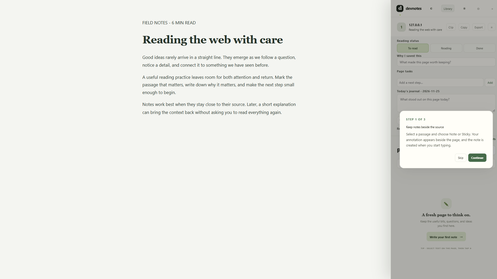

# DevNotes

DevNotes is a local-first Chrome extension for notes, highlights, and reading tasks attached to the pages you visit. Its React interface runs in a closed Shadow DOM so the panel and annotation styles stay separate from the website.



## Install for development

```sh
npm ci
npm run build
```

Open `chrome://extensions`, enable **Developer mode**, select **Load unpacked**, and choose the generated `dist` folder. The popup build is also used for local preview; the extension content script mounts on HTTP and HTTPS pages.

## Use DevNotes

- Select page text to highlight it or create an inline note or sticky. The toolbar can be set to Always, Hold Alt, or Never; `Alt+Shift+H` highlights and `Alt+Shift+M` starts a note.
- Open the floating launcher to add page notes, tasks, tags, reading status, a reason for saving, and a dated journal entry.
- Use the Library to search and organize notes, browse the daily reading digest, or step through review items by site or tag.
- Export the current page as Markdown or export and restore a full JSON backup.
- Choose light, dark, system, or sepia themes and adjust text size in Settings.

All changes save to local browser storage. There is no account, remote sync, or telemetry. Backups are files you choose to export; captured notes and page text are stored locally and are not encrypted.

## Permissions

| Permission | Purpose |
| --- | --- |
| `storage` | Save notes, highlights, settings, and backups in Chrome local storage. |
| `unlimitedStorage` | Support larger local note libraries. |
| `contextMenus` | Add selection capture to the browser context menu. |
| `scripting` | Reconnect the content script on tabs already open when the extension starts. |
| HTTP/HTTPS host access | Attach notes and restore highlights on visited web pages. |

The extension scans visible text on a page to find saved highlight anchors. It automatically disables itself on pages with password fields and supports a user-managed host blocklist. Incognito data is kept in memory for that session.

## Development checks

```sh
npm run typecheck
npm run lint
npm run test:unit
npm run check:contrast
npm run build
npm run test:e2e
```

The unit suite covers URL normalization, merge and tombstone behavior, backup validation, highlight restoration, and legacy note-body cleanup. The Playwright test loads the built MV3 extension in Chromium and checks that the content script mounts on a web page. CI runs these checks on pushes and pull requests.

## Known limitations

- Cross-origin iframes, PDFs, canvas-based readers, and closed shadow roots cannot be annotated as ordinary page text.
- A site can dynamically replace content; highlights use quote and nearby-text matching and may need manual reattachment after substantial edits.
- Browser storage is local to the Chrome profile. Use an exported backup to move data between profiles.
- The extension is an early prototype; the first-run experience and annotation layout may vary across sites.
